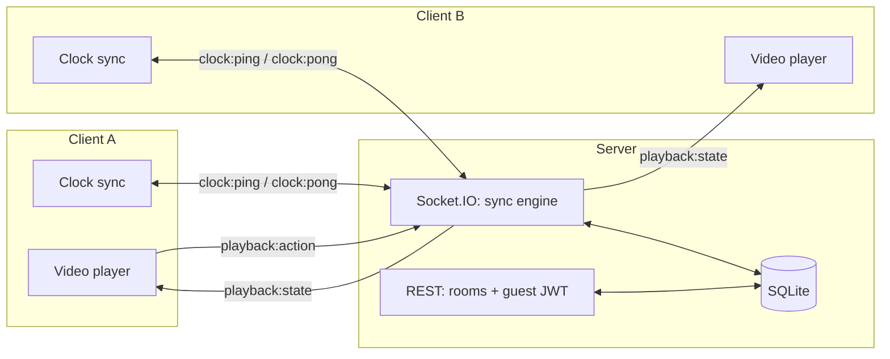

# Watch Party

Paste a video link, share a room code, watch together — perfectly in sync,
even across different networks, devices, and clocks.

A full-stack real-time application built to demonstrate systems-level
engineering rather than CRUD: keeping playback synchronized across multiple
clients requires actively correcting for network latency and clock
disagreement, which is the core problem this project solves.

**Stack:** React 19 · Node.js / Express · Socket.IO · SQLite (zero native
dependencies) · JWT auth

---

## What it does

- **Create or join a room** with a short shareable code — no signup required
- **Synchronized playback** — play, pause, and seek propagate to everyone in
  the room in real time
- **Live chat** scoped to the room, persisted so it's there when you rejoin
- **Presence** — see who's currently in the room as they join and leave
- **Self-correcting drift** — a visible latency/drift readout shows the sync
  engine actively compensating for network conditions, live

## Why this is harder than "just broadcast an event"

If every client simply plays a video the instant it hears "play", clients
drift apart within seconds — different buffering, different clock speeds,
different network latency to the server. This project fixes that with:

1. **Clock offset estimation** — each client periodically pings the server
   and, using an NTP-style round-trip measurement, estimates how far its own
   clock differs from the server's.
2. **A single source of truth for position** — the server stores only
   `{ isPlaying, positionSeconds, updatedAt }`, never a continuously ticking
   number. Clients derive "where playback should be right now" by projecting
   that state forward through their corrected clock.
3. **Continuous correction, not just reaction** — every 300ms, each client
   compares its actual position to the expected one: small drift is smoothed
   via a subtle `playbackRate` nudge (inaudible), large drift (e.g. after a
   reconnect) triggers a hard seek.

Full write-up with code references: **[watch-party/README.md](watch-party/README.md)**

## Architecture



Room lifecycle (create, join, fetch state) is plain REST with short-lived
guest JWTs — no account system, matching how real watch-party products work.
Everything that needs to happen live — playback sync, chat, presence, clock
measurement — runs over a single Socket.IO connection.

## Project structure

```
watch-party/
├── server/            Express API + Socket.IO sync engine + SQLite
│   └── src/
│       ├── routes/    room create/join REST endpoints
│       ├── socket/     playback sync, chat, presence, clock ping/pong
│       └── models/     SQLite queries
└── client/            React (Vite) app
    └── src/
        ├── pages/      Home (create/join), Room (player + chat)
        ├── components/ VideoPlayer, Chat, ParticipantList
        └── lib/        clockSync.js (the drift-correction math), api, socket
```

## Running it locally

```bash
# terminal 1 — API on http://localhost:4000
cd watch-party/server && npm install && npm run dev

# terminal 2 — client on http://localhost:5173
cd watch-party/client && npm install && npm run dev
```

Open two browser tabs, create a room in one, join with its code in the
other, paste a direct `.mp4` URL, and hit play — both tabs stay in sync, with
a live drift/latency readout under the player.

There's also a scripted two-client integration check
(`watch-party/client/scripts/demo-flow.mjs`) that exercises room creation,
join, presence, playback sync, and chat directly against the running server —
useful for verifying the real-time layer without a browser.

## Deploying

The app deploys as a **single Render web service**: the client is built first
and Express serves the resulting `dist/` alongside the API. Because both halves
share one origin there's no CORS to configure and no API URL baked into the
bundle at build time — the two things most likely to silently break a split
deployment.

```bash
# what Render runs, reproduced locally
cd watch-party/client && npm ci && npm run build
cd ../server && npm ci && NODE_ENV=production JWT_SECRET=dev npm start
# whole app on http://localhost:4000
```

To deploy: push to GitHub, then in Render choose **New → Blueprint** and point
it at the repo. `render.yaml` describes the whole service, generates
`JWT_SECRET` automatically, and health-checks `/api/health`. Node is pinned to
22.20 because the database uses the built-in `node:sqlite` module, which needs
Node ≥ 22.5.

Two things worth knowing about the free tier:

- **It sleeps after 15 minutes idle.** The first visitor after that waits ~50s,
  and since free instances have no persistent disk, the SQLite file resets and
  existing room codes stop working. The bundled keep-awake workflow below
  prevents both.
- **Run exactly one instance.** Presence is held in a process-local `Map` and
  there's no Redis adapter, so a second replica would split rooms — participants
  on different instances wouldn't see each other or receive each other's
  play/pause.

### Keeping it awake

`.github/workflows/keep-awake.yml` pings `/api/health` on a schedule so the
service never idles long enough to be spun down. After deploying, set the target
URL once:

**Settings → Secrets and variables → Actions → Variables → New variable**

| Name | Value |
| --- | --- |
| `PING_URL` | `https://<your-service>.onrender.com/api/health` |

Until that variable exists the workflow logs a reminder and exits successfully,
so it never fails noisily on a fresh clone. You can also run it on demand from
the Actions tab, and because it fails the run after three unsuccessful attempts
it doubles as a basic uptime alarm.

It runs every 10 minutes rather than 15 deliberately — 15 would race Render's
own idle threshold exactly, and GitHub's scheduled runs are best-effort and
frequently start several minutes late. Actions minutes are unlimited on public
repositories, so this is free.

Two caveats worth knowing:

- **GitHub disables scheduled workflows after 60 days without a commit** to the
  repository. If the project goes quiet, re-enable it from the Actions tab.
- Keeping one service up continuously uses ~744 of Render's 750 free instance
  hours per month, which is fine for this service alone but leaves no headroom
  for a second free service on the same account.

If you'd rather not depend on GitHub's scheduler, any external uptime monitor
pointed at the same URL does the same job with more reliable timing.

## Roadmap

- Host-only playback controls with a "request control" flow
- Reconnect replay for chat missed while offline
- YouTube IFrame adapter using the same sync engine (the engine itself is
  player-agnostic)
- WebRTC voice chat alongside text chat
