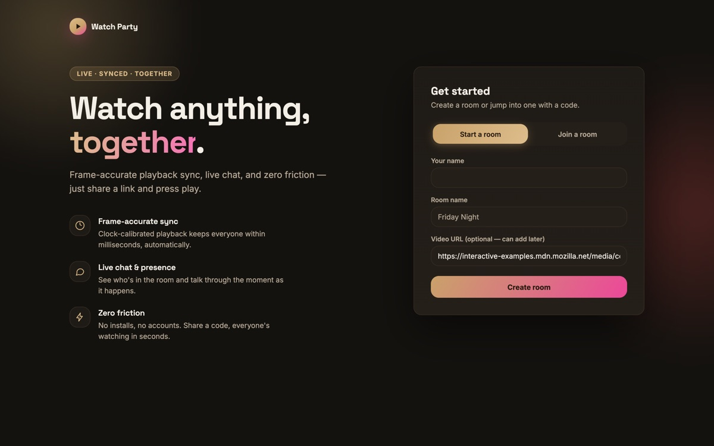
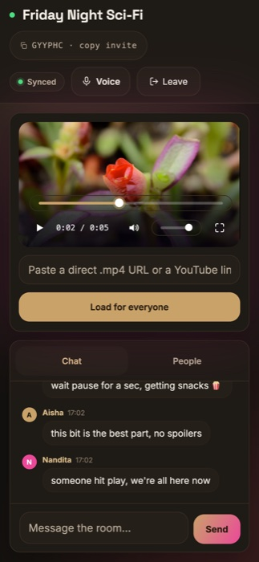
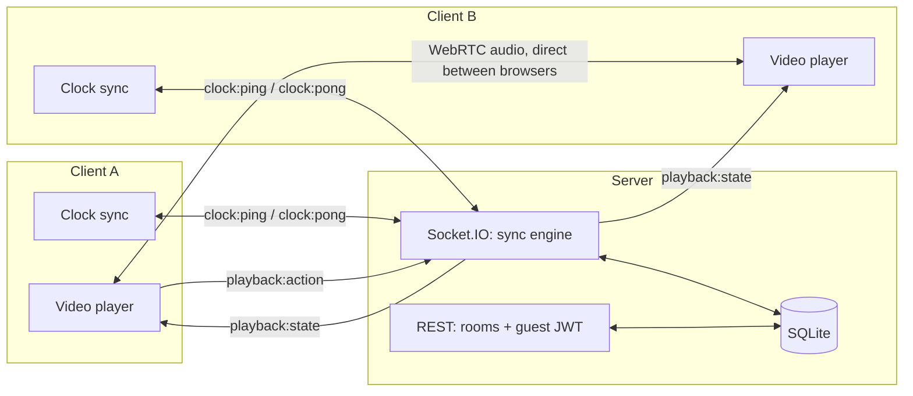

# Watch Party

[](https://github.com/Nandita-Dash/Watch-party/actions/workflows/test.yml)

Paste a video link, share a room code, watch together — perfectly in sync,
even across different networks, devices, and clocks.

**[▶ Open the live app](https://watch-party-cyqk.onrender.com)** — it runs on a
free Render instance, so the first request after a quiet spell takes ~50s to
wake up.


A full-stack real-time application built to demonstrate systems-level
engineering rather than CRUD: keeping playback synchronized across multiple
clients requires actively correcting for network latency and clock
disagreement, which is the core problem this project solves.

**Stack:** React 19 · Node.js / Express · Socket.IO · WebRTC · SQLite (zero
native dependencies) · JWT auth

| Landing | On a phone |
| --- | --- |
|  |  |

---

## What it does

- **Create or join a room** with a short shareable code — no signup required
- **Synchronized playback** — play, pause, and seek propagate to everyone in
  the room in real time
- **Direct video files or YouTube** — both drive the same sync engine through
  a small player adapter interface
- **Voice chat** — opt-in, peer-to-peer WebRTC audio alongside the video
- **Live chat** scoped to the room, persisted and replayed on reconnect, so
  messages sent while you were offline aren't lost
- **Presence** — see who's currently in the room as they join and leave
- **A live sync indicator** in the room header — `Syncing…` / `Synced` /
  `Drifting`, with the exact drift and round-trip latency in its tooltip
- **Works on any screen** — one-viewport layout, with the sidebar collapsing
  to Chat / People tabs on phones

## Why this is harder than "just broadcast an event"

If every client simply plays a video the instant it hears "play", clients
drift apart within seconds — different buffering, different clock speeds,
different network latency to the server. This project fixes that with:

1. **Clock offset estimation** — each client periodically pings the server
   and, using an NTP-style round-trip measurement, estimates how far its own
   clock differs from the server's.
2. **A single source of truth for position** — the server stores only
   `{ isPlaying, positionSeconds, updatedAt }`, never a continuously ticking
   number. Clients derive "where playback should be right now" by projecting
   that state forward through their corrected clock.
3. **Continuous correction, not just reaction** — every 300ms, each client
   compares its actual position to the expected one: small drift is smoothed
   via a subtle `playbackRate` nudge (inaudible), large drift (e.g. after a
   reconnect) triggers a hard seek.

Full write-up with code references: **[watch-party/README.md](watch-party/README.md)**

## Architecture



Room lifecycle (create, join, fetch state) is plain REST with short-lived
guest JWTs — no account system, matching how real watch-party products work.
Everything that needs to happen live — playback sync, chat, presence, clock
measurement, voice signaling — runs over a single Socket.IO connection. Voice
*audio* never touches the server: it flows directly between browsers.

### Realtime protocol

| Event | Direction | Purpose |
| --- | --- | --- |
| `clock:ping` → `clock:pong` | client ↔ server | round-trip and offset measurement |
| `playback:action` | client → server | play / pause / seek intent, with the client's position |
| `playback:state` | server → room | the new authoritative `{ isPlaying, positionSeconds, updatedAt }` |
| `video:load` → `video:changed` | client → room | swap the source everyone is watching |
| `video:rejected` | server → sender | the URL was refused — only the sender hears it |
| `chat:message` | client ↔ room | persisted, then broadcast |
| `chat:sync` → `chat:missed` | client ↔ server | replay messages that arrived while this socket was offline |
| `presence:list` / `:join` / `:leave` | server → room | who's in the room right now |
| `voice:join` / `voice:leave` | client → server | opt in or out of voice, independently of room presence |
| `voice:roster` / `voice:peer-joined` / `voice:peer-left` | server → client | who's currently in voice |
| `voice:offer` / `voice:answer` / `voice:ice-candidate` | relayed, peer to peer | WebRTC signaling, targeted at one socket — never broadcast |

Chat, playback actions, and video loads each perform a synchronous SQLite
write, which blocks the event loop for every connected client — so all of
them, plus the `voice:*` events, are rate limited per socket.

### Voice chat

Voice is a **full mesh**: every participant holds a direct `RTCPeerConnection`
to every other. The server is a switchboard that relays offers, answers, and
ICE candidates between two peers and never sees or forwards audio. The joiner
always initiates — it fetches the roster and offers to each existing member,
while existing members wait — which is what stops two peers from colliding
with simultaneous offers.

Two consequences worth knowing: a mesh is `n(n-1)/2` connections, so it suits
small groups rather than large rooms, and signaling uses **public STUN with no
TURN server**, so audio fails for the minority of participants behind
symmetric NAT.

## Project structure

```
watch-party/
├── server/            Express API + Socket.IO sync engine + SQLite
│   └── src/
│       ├── routes/     room create/join REST endpoints
│       ├── socket/     playback sync, chat, presence, clock, voice signaling
│       └── models/     SQLite queries
└── client/            React (Vite) app
    └── src/
        ├── pages/      Home (landing + create/join), Room (player + sidebar)
        ├── components/ VideoPlayer, Chat, ParticipantList
        └── lib/        clockSync.js    the drift-correction math
                        youtubePlayer.js YouTube IFrame adapter
                        useVoiceChat.js  mesh WebRTC hook
                        api, socket, session, avatar, useReveal
```

## Running it locally

Requires **Node ≥ 22.12** — the database uses the built-in `node:sqlite`
module (≥ 22.5) and the client builds with Vite 8 (≥ 22.12). No `.env` file is
needed; the client falls back to `http://localhost:4000` in dev.

```bash
# terminal 1 — API on http://localhost:4000
cd watch-party/server && npm install && npm run dev

# terminal 2 — client on http://localhost:5173
cd watch-party/client && npm install && npm run dev
```

Open two browser windows — one normal, one incognito, since tokens live in
`sessionStorage` and tabs in the same window share an identity. Create a room
in one, join with its code in the other, load a video, and hit play: both stay
in sync, and the header pill reports the drift.

There's also a scripted two-client integration check
(`watch-party/client/scripts/demo-flow.mjs`) that exercises room creation,
join, presence, playback sync, and chat directly against the running server —
useful for verifying the real-time layer without a browser.

## Deploying

The app deploys as a **single Render web service**: the client is built first
and Express serves the resulting `dist/` alongside the API. Because both halves
share one origin there's no CORS to configure and no API URL baked into the
bundle at build time — the two things most likely to silently break a split
deployment.

```bash
# what Render runs, reproduced locally
cd watch-party/client && npm ci && npm run build
cd ../server && npm ci && NODE_ENV=production JWT_SECRET=dev npm start
# whole app on http://localhost:4000
```

To deploy: push to GitHub, then in Render choose **New → Blueprint** and point
it at the repo. `render.yaml` describes the whole service, pins Node to
22.20.0, generates `JWT_SECRET` automatically, and health-checks `/api/health`.

Three things worth knowing:

- **The client install needs `--include=dev`.** Render sets
  `NODE_ENV=production`, which makes npm skip devDependencies — and Vite is
  one. Without the flag the build fails with `vite: command not found`.
- **The free tier sleeps after 15 minutes idle.** The first visitor after that
  waits ~50s, and since free instances have no persistent disk, the SQLite file
  resets and existing room codes stop working. The keep-awake workflow below
  prevents both.
- **Run exactly one instance.** Presence and the voice roster are process-local
  `Map`s with no Redis adapter, so a second replica would split rooms —
  participants on different instances wouldn't see each other, receive each
  other's play/pause, or be able to reach each other in voice.

<details>
<summary><strong>Keeping the free instance awake</strong></summary>

`.github/workflows/keep-awake.yml` pings `/api/health` on a schedule so the
service never idles long enough to be spun down. After deploying, set the target
URL once, under **Settings → Secrets and variables → Actions → Variables → New
variable**:

| Name | Value |
| --- | --- |
| `PING_URL` | `https://watch-party-cyqk.onrender.com/api/health` |

Until that variable exists the workflow logs a reminder and exits successfully,
so it never fails noisily on a fresh clone — which also means a green run does
not by itself prove anything is being pinged. Check a run's log for
`PING_URL is not set` if the service is still going to sleep. You can trigger a
ping by hand from the Actions tab, and because the job fails after three
unsuccessful attempts it doubles as a basic uptime alarm.

It runs every 10 minutes rather than 15 deliberately — 15 would race Render's
own idle threshold exactly, and GitHub's scheduled runs are best-effort and
frequently start several minutes late. Actions minutes are unlimited on public
repositories, so this is free.

Two caveats:

- **GitHub disables scheduled workflows after 60 days without a commit** to the
  repository. If the project goes quiet, re-enable it from the Actions tab.
- Keeping one service up continuously uses ~744 of Render's 750 free instance
  hours per month, which is fine for this service alone but leaves no headroom
  for a second free service on the same account.

If you'd rather not depend on GitHub's scheduler, any external uptime monitor
pointed at the same URL does the same job with more reliable timing.

</details>

## Roadmap

- Host-only playback controls with a "request control" flow
- A TURN server, so voice works from behind symmetric NAT
- More player adapters — Vimeo, Twitch — reusing the existing sync engine
- Redis adapter for presence and the voice roster, so the service can run more
  than one instance

## License

[MIT](LICENSE)
